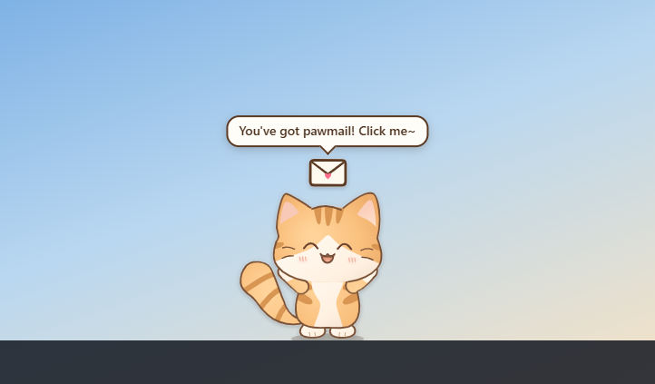
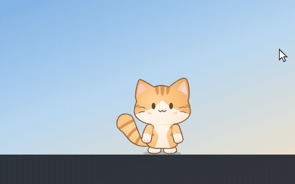
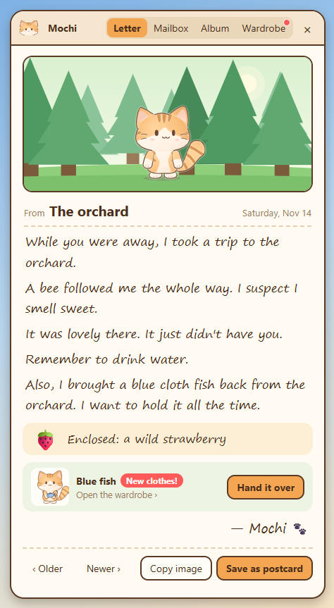
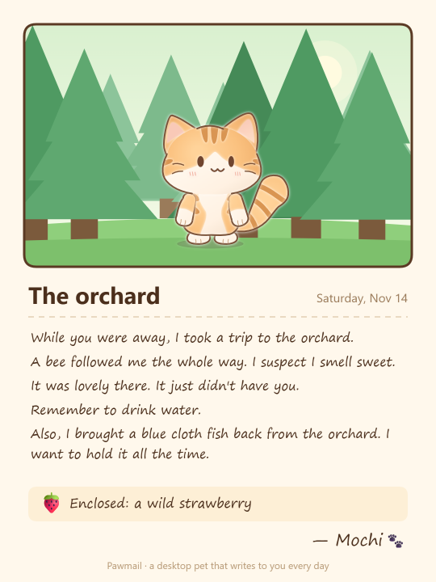
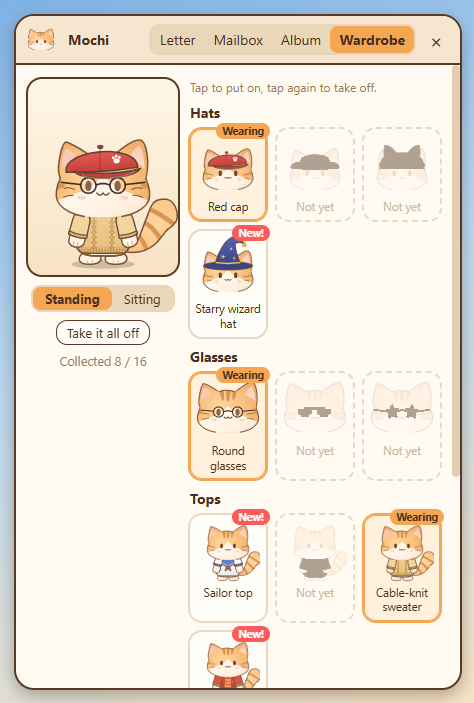
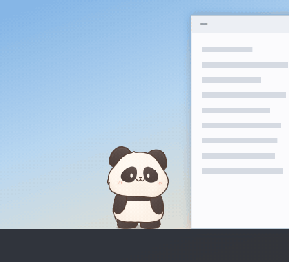

# Pawmail 🐾

**[中文说明](README.zh-CN.md)**

A tiny pet that lives on your Windows desktop. It wanders, naps and chases your cursor. While you're away it goes exploring, and the next day it greets you with a letter about where it went, sometimes with a little gift enclosed.

> **Free beta** for Windows 10 and 11. Everything stays on your computer; nothing is uploaded.

## What it does

**It lives on your desktop.** An orange cat, a panda, a capybara, a Shiba Inu or a red panda walks along your taskbar. It breathes, blinks, twitches its ears, follows your cursor with its eyes, and decides for itself what to do next: nap, groom, wander, climb, or come say hi. Your clicks go straight through it to the windows behind, unless you're pointing at the pet itself.

Pick it up by the scruff and it dangles, swings and wriggles. Let go and it drops back down.

**A letter every day.** The first time you come back each day, it's holding a letter for you. It writes about where it went (21 places, some only in certain seasons), a little thing that happened there, and a line about you: *"You stayed up until 1:40 last night"*, *"That's 7 days in a row we've seen each other"*. About two in three letters come with a gift: 38 to collect in the album, plus festival-only ones. Every letter can be saved as a postcard image to share.

  
  &nbsp;
  

**A wardrobe.** 16 hats, glasses, tops, bags and things to hold. It starts with three; the rest arrive with its letters. Dress it up and it looks down at its new clothes, spins around and asks how it looks.

**It eats your files.** Drag files you don't need onto it and it gobbles them up. They really go to the Recycle Bin, so you can always get them back. It won't eat anything that can't be recovered (USB drives, network drives) or anything important (whole drives, Windows, your Desktop or Documents folders themselves).

**It climbs.** At the edge of the screen, or of the play area you draw for it, it sometimes climbs up hand over hand, looks around, and jumps back down.

**And also:**

- Each animal has its own temper: the cat is the liveliest, the panda is a big softie, the capybara takes things slowly (sit it down long enough and an orange may land on its head), the Shiba Inu has a mind of its own (now and then it flops down mid-walk and refuses to budge), and the red panda is a bit timid but loves heights (startle it and it stands up tall with its arms raised to look fierce).
- Birthdays and festivals: Lunar New Year, Mid-Autumn, Halloween, Christmas and more (you choose which ones you celebrate). On the day it dresses up, sends a festival letter with a festival-only gift, and greets you in its own way.
- A monthly letter about your month together, and a year in review on New Year's Day.
- Drop it on top of a window and it perches there: it strolls along the top, naps, peeks over the edge, and rides along when you drag the window. Close the window and down it goes. Sometimes it gets up there by itself, hopping onto a low window or climbing the side of one that reaches down to the taskbar.
- Hides by itself while a game or video is full-screen, and comes back when you're done.
- Draw a box to keep it in one part of the screen.
- English and Chinese.

## Download and install

Download the latest version from the **[Releases](../../releases/latest)** page. There are two kinds:

- **`Pawmail-Setup-x.y.z.exe`**: an installer. Double-click it; it installs for your account only (no admin needed) and starts Pawmail.
- **`Pawmail-x.y.z-win-x64.zip`**: no install. Unzip it anywhere and double-click `Pawmail.exe`.

**"Windows protected your PC"**: the first time you run it, Windows may show this blue warning. Click **More info**, then **Run anyway**. It appears because Pawmail isn't code-signed (signing certificates cost hundreds of dollars a year, which a free beta can't justify). All of the source code is in this repository.

To start it every time you sign in, right-click the pet and turn on **Start at login**.

It's about 140 MB to download and uses around 175 MB of memory while running (what Task Manager shows), most of which is Electron, the framework it's built with.

## How to play

| Do this | And |
|---|---|
| Click it while it's holding a letter | Open the letter |
| Right-click it | Menu: mailbox, wardrobe, animal, display, size, language, start at login, perch on windows, play area, sleep, quit |
| Move the mouse back and forth over it | Pet it |
| Click it | Poke it |
| Double-click it | It hops happily |
| Press and drag | Pick it up. Let go to drop it; let go while moving to throw it |
| Drag files onto it | Feed them to it (they go to the Recycle Bin) |
| Drop it on the top edge of a window | It stands up there; drag the window and it rides along |
| Click it while it's climbing | It jumps down |
| The tray icon (bottom-right of the screen) | The same menu, plus *Call it back*, *Whole screen*, *Hide during full-screen apps* and *Help & feedback* |

Can't find the tray icon? Windows 11 tucks new icons behind the `^` arrow on the taskbar.

In the letter window: drag the top bar to move it, click the pet's name to change its name, your birthday and your festivals, use ← → to flip through letters, Esc to close.

## Privacy

- Everything is saved only on your computer, in `%APPDATA%\Pawmail\save.json`. Pawmail never connects to the internet.
- To write its letters, it notes a few things each day: when you first and last used the computer, for how many minutes, and how many times you petted, poked or threw it. Only the last 60 days are kept.
- Your birthday (month and day only) and your festivals are stored in the same file.
- Files you feed it go to the Recycle Bin. It only counts how many; it doesn't record names or look inside.
- To hide during full-screen apps, it checks twice a second whether the frontmost window exactly covers the screen. It looks only at the window's size, never at which program it is, and records nothing.
- To perch on windows, it checks twice a second where the windows on your screen are: their position, size and which one is in front. It never looks at window titles or which program a window belongs to, and records nothing. You can turn this off in the menu (*Perch on windows*).
- It does **not** record your keystrokes, programs or websites.
- Postcards are saved only when you click *Save as postcard* (into `Pictures\Pawmail`).
- It keeps a small log of what the app itself did, such as errors and when it hid for a full-screen app, in `%APPDATA%\Pawmail\logs` (about 1 MB at most), so you can attach it to a bug report. Your Windows user name is replaced with `~`. The log is never sent anywhere.

## Uninstall

- Installed with the installer: *Settings → Apps → Installed apps → Pawmail → Uninstall*.
- The zip version: if you turned on *Start at login*, turn it off first (right-click → *Start at login → Off*). Then quit Pawmail (right-click → *Quit Pawmail*) and delete its folder.

Uninstalling keeps your letters and gifts, so they're still there if you reinstall. To remove them too, delete the folder `%APPDATA%\Pawmail`.

## Good to know

- This is a beta. There's no automatic update yet. To see if there's a newer version, use the tray icon → *Help & feedback → Check for updates…* (it opens the download page in your browser). To update, install or unzip the new version over the old one. Your letters carry over.
- It lives on your main monitor only.
- The gift icons are emoji for now; original icons are coming.
- Found a bug, or have an idea? Please open an [issue](../../issues). For a bug, attaching the log helps a lot: tray icon → *Help & feedback → Open log folder*, then add `pawmail.log`.

## License

The **code** is MIT-licensed (see [LICENSE](LICENSE)). The **artwork, characters and writing** (the pets, clothes, letters and names) are not; all rights reserved, see [ASSETS-LICENSE.md](ASSETS-LICENSE.md). You're welcome to share screenshots and videos.

## For developers

How to run it from source, the code layout and the test tools are in [DEVELOPMENT.md](DEVELOPMENT.md) (in Chinese).
