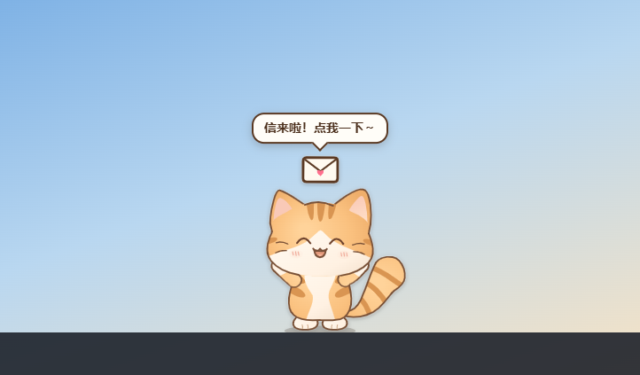
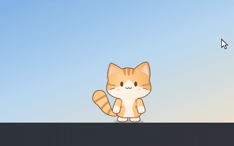
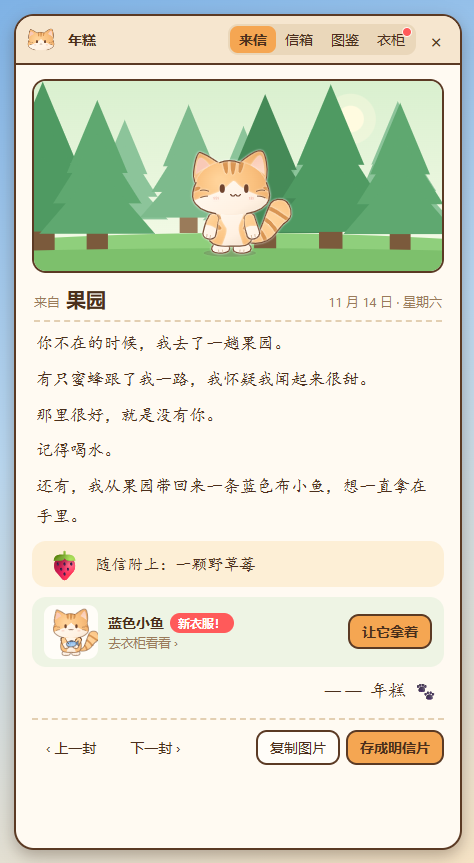
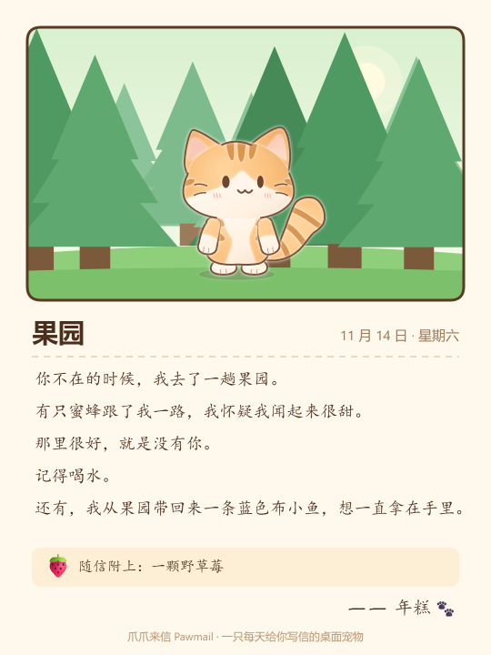
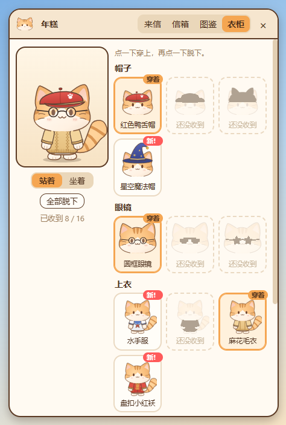
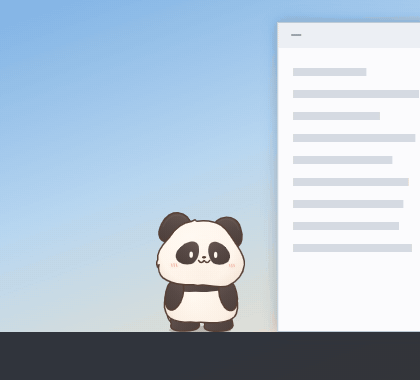

# 爪爪来信 Pawmail 🐾

**[English](README.md)**

一只住在你 Windows 桌面上的小动物。它会自己散步、打瞌睡、追你的鼠标；你不在的时候它会出门转转，第二天你回到电脑前，它就抱着一封信等你拆——讲讲它去了哪儿，有时还随信附上一件小礼物。

> **免费测试版**，支持 Windows 10 和 11。所有数据只存在你自己的电脑上，不上传。

## 它能做什么

**住在你的桌面上。** 一只橘猫、熊猫、卡皮巴拉、柴犬、小熊猫或兔子在任务栏上走来走去。它会呼吸、眨眼、抖耳朵，眼睛跟着你的鼠标转，自己决定接下来做什么：打个盹、舔舔爪子、溜达、爬墙，或者过来跟你打招呼。鼠标不在它身上时，点击会直接穿过它，点到后面的窗口。

拎住它的后脖子提起来，它会挂着晃来晃去、蹬腿扭一扭；一松手就掉回地上。

**每天一封信。** 每天第一次回到电脑前，它手里都抱着一封给你的信。信里写它去了哪儿（21 个地方，有的只在特定季节去）、在那儿遇到的小事，还有一句关于你的话："你昨天凌晨 1 点 40 才睡"、"我们已经连续 7 天见面了"。大约三分之二的信附有礼物：图鉴里有 38 件可以收集，另外还有节日限定的。每封信都能存成一张明信片图片，发给朋友。

  
  &nbsp;
  

**衣柜。** 帽子、眼镜、上衣、包包、手里拿的东西，一共 50 件。一开始送 3 件，其余的随信寄来。给它换上新衣服，它会低头看看、转一圈，问你好不好看。

**待办提醒。** 在信纸窗口的"待办"页里写下要做的事，可以让它到点提醒你（30 分钟后、今晚 8 点、明早 9 点，或者自己选个时间）。到点了它会举着一张画着小闹钟的便签跑到你鼠标旁边，点它一下就算知道了。每勾掉一件，它都会替你高兴；第二天的信里还会提一句。

**喂它吃文件。** 把不要的文件拖到它身上，它张嘴吧唧吧唧吃掉。其实是放进了回收站，后悔了随时能找回来。找不回来的（U 盘、网络盘上的东西）和重要的（整个磁盘、Windows 文件夹、"桌面""文档"文件夹本身）它不吃。

**爬墙。** 走到屏幕边上（或者你给它画的活动范围的边上），它有时会两只爪子轮流往上爬，在上面东张西望，再蹬墙跳下来。

**还有：**

- 每种动物各有各的脾气，还各有三个招牌动作：
  - 橘猫：踩奶，拍着毛线球满地追（站在窗口上时会把球拨下去），钻进纸箱只露出脑袋；招财猫还会招手，蹦出小铜钱。
  - 熊猫：缩成一团打个滚，打瞌睡歪倒在一边，靠着墙蹭背挠痒痒。
  - 卡皮巴拉：慢悠悠的，坐着发呆时头顶会落下一个橘子，会泡温泉，小鸟会落在它头上。
  - 柴犬：很有主见，散步散到一半会趴下赖着不走；会叼来一个球或者骨头放到你鼠标旁边，你拖着它扔出去（或者点一下），它就追过去叼回来，右键「陪它玩球」随时开始；还会转着圈追自己的尾巴。
  - 小熊猫：胆子小、最爱爬高，被吓到会站起来举起双手"吓唬"你；会趴在窗口边上睡，手脚和尾巴垂下去；睡觉时抱着自己的大尾巴。
  - 兔子：走路一蹦一蹦的，跳得最高；开心到极点会蹦起来在半空中扭一下；会搓脸，把长耳朵拉下来舔干净；觉得安心时"啪叽"侧身一倒，睡个小觉。
  - 大家都会掏出自己爱吃的零食（小鱼干、竹子、西瓜、肉干、苹果、胡萝卜）一口一口啃。想马上看一个：右键 → *来一个！*
- 生日和节日：春节、中秋、万圣节、圣诞节等等（过哪些节由你选）。过节那天它会换上节日装扮，寄来节日信和节日限定礼物，还会用自己的方式跟你打招呼。
- 每月一封月报，讲讲你们这个月；元旦那天是一整年的回顾。
- 把它放到某个窗口的顶上，它就站在那儿：在上面溜达、打盹、探头往下看；你拖动那个窗口，它跟着一起走。窗口一关，它就掉下来。它有时也会自己上去：跳上不太高的窗口，或者顺着一直伸到任务栏的窗口侧边爬上去。
- 你全屏打游戏、看视频时，它会自己躲起来，退出全屏再回来。
- 凌晨 0:30 以后你还在用电脑，它会抱着小枕头跑来劝你睡觉（一晚最多 3 次，第 3 次劝完它自己先去睡了）。
- 笔记本快没电时（20% 以下、没插电），它也跟着蔫了，提醒你插上电源；插上电又精神了。
- 可以画一个方框，让它只在屏幕的一块地方活动。
- 中文 / English。

## 下载和安装

在 **[Releases](../../releases/latest)** 页面下载最新版本，有两种：

- **`Pawmail-Setup-x.y.z.exe`**：安装程序。双击就装好（只装给你自己，不需要管理员权限），装完自动打开。
- **`Pawmail-x.y.z-win-x64.zip`**：免安装版。解压到任意地方，双击里面的 `Pawmail.exe`。

**"Windows 已保护你的电脑"**：第一次运行时，Windows 可能弹出这个蓝色提示。点 **更多信息**，再点 **仍要运行** 就行。出现这个提示，是因为爪爪来信没有做代码签名：签名证书一年要花上千元，免费的测试版暂时不买。全部源代码都在这个仓库里。

想每次开机自动启动：右键点它，把 **开机启动** 打开。

下载约 140 MB，运行时大约占 175 MB 内存（任务管理器里看到的数字），大部分是它用的框架 Electron 本身。

## 怎么和它玩

| 操作 | 效果 |
|---|---|
| 它手里拿着信时，点它一下 | 拆信 |
| 右键点它 | 菜单：信箱、衣柜、来一个！（马上表演一个招牌动作）、陪它玩球（柴犬）、待办、换动物、显示方式、大小、语言、开机启动、站到窗口上、画活动范围、哄睡、退出 |
| 它举着便签提醒你待办时，点它一下 | 知道了（这件不再提醒） |
| 柴犬把球（骨头）放到你跟前时，按住它拖着扔出去，或者点一下 | 飞出去，它追过去叼回来 |
| 鼠标在它身上来回移动 | 摸头 |
| 左键点一下 | 戳它一下 |
| 双击 | 它开心地蹦两下 |
| 按住拖动 | 把它拎起来；松手会掉下来，带着速度松手可以把它扔出去 |
| 把文件拖到它身上 | 喂它吃掉（放进回收站） |
| 把它拎到某个窗口的顶边上松手 | 它站在窗口上；拖动窗口，它跟着走 |
| 它爬墙的时候点它 | 它跳下来 |
| 托盘图标（屏幕右下角） | 同样的菜单，另外还有"叫它回来""整个屏幕""全屏时躲起来""帮助与反馈" |

找不到托盘图标？Windows 11 会把新图标收进任务栏右边的 `^` 小箭头里。

在信纸窗口里：拖顶栏可以挪窗口，点它的名字可以改名字、你的生日和过的节日，键盘 ← → 翻信，Esc 关闭。

## 隐私

- 所有数据只保存在你自己的电脑上（`%APPDATA%\Pawmail\save.json`）。爪爪来信从不联网。
- 为了写信，它每天记下几件事：你第一次和最后一次用电脑的时间、一共用了多少分钟，以及那天你摸了它几次、戳了几次、扔了几次。只保留最近 60 天。
- 你告诉它的生日（只有月和日）和过哪些节日，也只存在这个文件里。
- 喂给它吃的文件只是放进回收站；它只记"喂了几样"，不记文件名，也不看文件内容。
- 你写的待办也只存在这个文件里（做完 30 天后自动清掉）；日志里只记"提醒了一次"，不记你写了什么。
- 为了在全屏时躲起来，它每秒看两次"最前面的窗口是不是正好铺满了整个屏幕"。只看窗口的大小，不看那是哪个程序，也不记录。
- 为了能站到窗口上，它每秒看两次屏幕上的窗口在哪儿：位置、大小，以及谁在前谁在后。不看窗口标题，不看是哪个程序的窗口，也不记录。不想要的话，可以在菜单里关掉（*站到窗口上*）。
- 为了在笔记本快没电时提醒你，它会看电池的电量和有没有插电。只看，不记录。
- 它**不会**记录你按了什么键、打开了什么程序或网页。
- 明信片只有在你点"存成明信片"时才会保存（在"图片\Pawmail"文件夹里）。
- 它会在 `%APPDATA%\Pawmail\logs` 里留一份小日志（最多 1 MB 左右），记的是程序自己的情况，比如出了什么错、什么时候因为全屏躲了起来，方便你反馈问题时附上。日志里你的 Windows 用户名会换成 `~`，也不会被发到任何地方。

## 卸载

- 用安装程序装的：*设置 → 应用 → 安装的应用 → Pawmail → 卸载*。
- 免安装版：如果开过"开机启动"，先把它关掉（右键 → *开机启动 → 关*）；再退出爪爪来信（右键 → *退出爪爪来信*），最后删掉它的文件夹。

卸载不会删掉你的信和礼物，以后重新装上还在。想连它们一起删掉，删除文件夹 `%APPDATA%\Pawmail`。

## 你可能想知道

- 这是测试版，还不会自动更新。想看看有没有新版本：托盘图标 → *帮助与反馈 → 检查新版本…*（会用浏览器打开下载页）。要更新的话，把新版本装在原来的位置（或者解压覆盖）就行，信都还在。
- 它只在主显示器上活动。
- 发现问题、有想法？欢迎在 [Issues](../../issues) 里告诉我们。反馈问题时附上日志会很有帮助：托盘图标 → *帮助与反馈 → 打开日志文件夹*，把 `pawmail.log` 一起发上来。

## 许可

**代码**用 MIT 许可证（见 [LICENSE](LICENSE)）。**美术、角色和文字**（宠物、衣服、信、名字）不在其中，保留所有权利，见 [ASSETS-LICENSE.md](ASSETS-LICENSE.md)。欢迎截图、录屏分享。

## 开发

从源代码运行、代码结构、测试工具，见 [DEVELOPMENT.md](DEVELOPMENT.md)。
